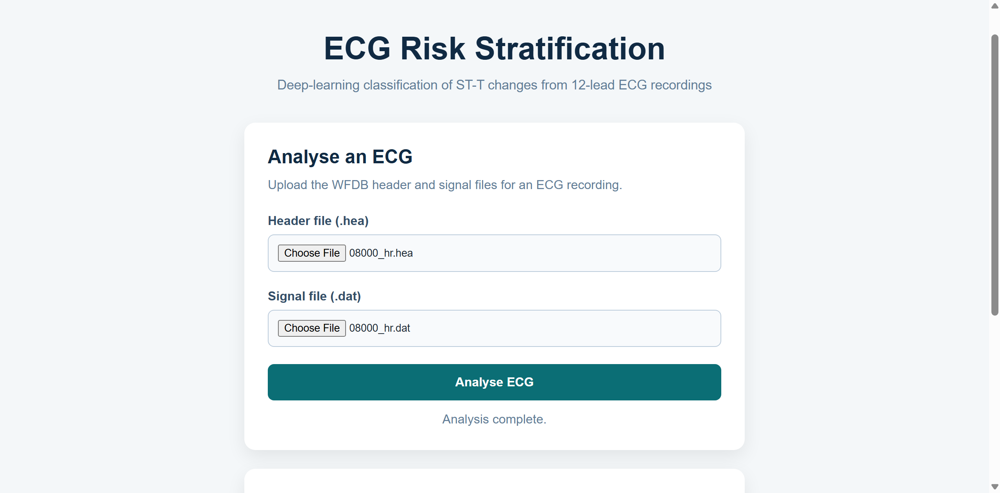
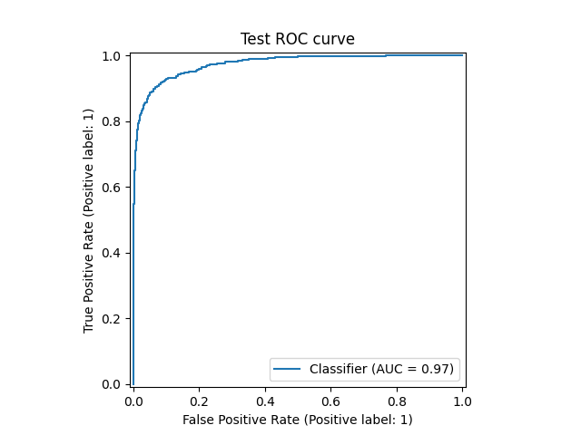
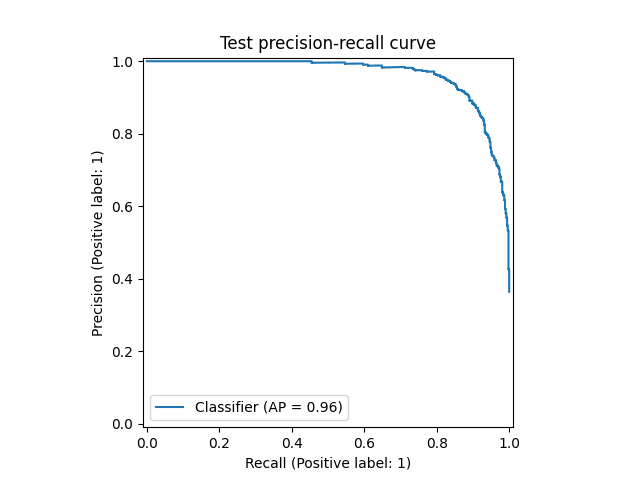
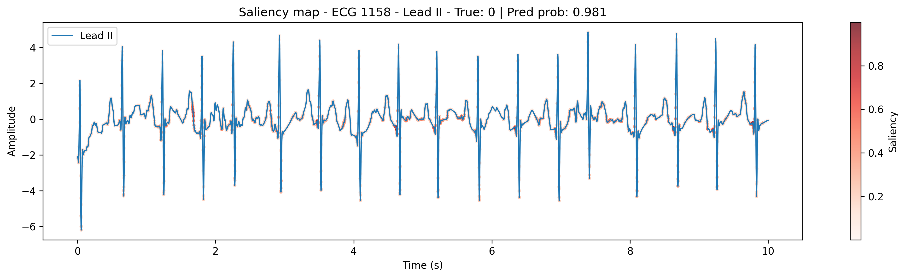

# ECG ST/T Change Classification

An end-to-end deep-learning pipeline for identifying ST/T abnormalities (STTC) from 12-lead ECG recordings using the PTB-XL dataset, with external validation on the independent Chapman–Shaoxing ECG database.

The project combines ECG signal preprocessing, a PyTorch 1D convolutional neural network, held-out test evaluation, external validation, gradient-based interpretability, a deployed FastAPI inference service, and a browser-based ECG upload interface.

## Demo



## Live Project

- **Web App:** [Try the ECG classifier](https://bentjones.github.io/ecg_analysis/)
- **API Documentation:** [FastAPI Swagger Docs](https://ecg-analysis-ws6t.onrender.com/docs)
- **API Health Check:** [Render API](https://ecg-analysis-ws6t.onrender.com/health)

---


## Model Performance

The CNN was trained on PTB-XL and evaluated on two independent evaluation sets:

1. **Internal test set:** 1,433 held-out PTB-XL recordings from fold 10, with no patient overlap between training, validation, and testing.
2. **External validation:** 4,285 Chapman–Shaoxing recordings, evaluated without retraining, fine-tuning, or threshold optimisation.


### Performance Comparison


| Metric         | PTB-XL Test | Chapman–Shaoxing |
| -------------- | ----------- | ---------------- |
| ECG recordings | 1,433       | 4,285            |
| Accuracy       | 92.04%      | 87.61%           |
| AUROC          | 0.974       | 0.934            |
| AUPRC          | 0.964       | 0.973            |
| F1 Score       | 0.893       | 0.909            |
| Sensitivity    | 90.79%      | 90.72%           |
| Specificity    | 92.76%      | 80.97%           |


Both datasets were evaluated using the same trained model and validation-selected classification threshold of **0.3773**.

### Internal Test Performance

**ROC Curve**



**Precision–Recall Curve**



The model achieved an AUROC of **0.9742** and an F1 score of **0.8925** on the held-out PTB-XL test set.

For the complete internal evaluation, including threshold comparison, error analysis, and saliency results, see [Test Set Evaluation](results/TEST_SET_EVALUATION.md).

### External Validation

To assess generalisation beyond PTB-XL, the pretrained CNN was evaluated on the [Chapman–Shaoxing 12-lead ECG dataset](https://www.kaggle.com/datasets/erarayamorenzomuten/chapmanshaoxing-12lead-ecg-database).

The external validation cohort contained:


| Class                         | Records   |
| ----------------------------- | --------- |
| Normal sinus rhythm proxy (0) | 1,366     |
| ST/T abnormality proxy (1)    | 2,919     |
| **Total**                     | **4,285** |


External recordings underwent the same signal preprocessing as the training data. Diagnostic labels were derived from selected SNOMED CT codes, rather than PTB-XL diagnostic superclasses.

No external ECGs were used to update model weights or select the classification threshold.

**External Confusion Matrix**


|                     | Predicted Normal | Predicted STTC |
| ------------------- | ---------------- | -------------- |
| Actual Normal Proxy | 1,106            | 260            |
| Actual STTC Proxy   | 271              | 2,648          |


**ROC Comparison**


The model retained strong discriminative performance on the external dataset, achieving an AUROC of **0.9342**.

Compared with the PTB-XL test set:

- AUROC decreased from 0.9742 to 0.9342.
- Sensitivity remained approximately unchanged at 90.72%.
- Specificity decreased from 92.76% to 80.97%.
- F1 increased slightly, although this comparison is influenced by differences in class prevalence.

These findings provide preliminary evidence of cross-dataset generalisation, with reduced performance on externally labelled normal recordings.

However, differences in diagnostic coding and class definitions between PTB-XL and Chapman–Shaoxing limit direct comparability. The external results should therefore be interpreted as a proxy-label validation experiment rather than a direct clinical diagnostic benchmark.

The full external validation pipeline is implemented in:

- `src/external_data.py`
- `notebooks/external_validation.ipynb`

---


## Classification Target


### PTB-XL

PTB-XL SCP statements are mapped to their diagnostic superclasses before constructing the binary classification task.

- **Normal (0):** Diagnostic superclass is exactly `NORM`.
- **STTC (1):** Diagnostic superclasses contain `STTC`.
- Records that are neither pure `NORM` nor STTC-positive are excluded.

STTC-positive ECGs may contain additional diagnostic superclasses alongside `STTC`.

### Chapman–Shaoxing

The external validation dataset uses SNOMED CT diagnostic codes rather than PTB-XL superclass annotations.

The binary labels were approximated using the following definitions:

**Normal proxy (0):**

- `426783006` — Sinus rhythm

The negative class contains recordings where the diagnostic code set consists exclusively of this code.

**STTC proxy (1):**


| SNOMED CT Code | Description                  |
| -------------- | ---------------------------- |
| `428750005`    | Nonspecific ST-T abnormality |
| `429622005`    | ST depression                |
| `164934002`    | T-wave abnormality           |
| `59931005`     | T-wave inversion             |
| `164930006`    | ST interval abnormality      |
| `164931005`    | ST elevation                 |
| `55930002`     | ST-segment changes           |


Records containing at least one selected positive code are classified as STTC-positive, including those with additional diagnoses.

Records that do not meet either criterion are excluded.

**Important:** These definitions are not identical to PTB-XL's `NORM` and `STTC` superclasses. Sinus rhythm does not necessarily indicate an otherwise normal ECG, and the selected positive codes are an approximation of the PTB-XL STTC superclass.

---


## Pipeline

The project consists of a model-development pipeline and a separate external-validation pipeline.

### Model Development

```text
PTB-XL WFDB recordings
        |
        v
Diagnostic superclass extraction
        |
        v
NORM / STTC dataset selection
        |
        v
12-lead ECG loading at 500 Hz
        |
        v
Channels-first conversion
        |
        v
0.5–40 Hz band-pass filtering
        |
        v
Per-lead z-score normalisation
        |
        v
Train / validation / test split
        |
        v
1D convolutional neural network
        |
        v
Validation-selected model checkpoint
        |
        v
Sigmoid STTC probability
        |
        v
Decision threshold (0.3773)
        |
        v
Normal / STTC classification
```


### External Validation

```text
Chapman–Shaoxing WFDB recordings
        |
        v
SNOMED CT diagnostic code extraction
        |
        v
Binary proxy-label construction
        |
        v
Same ECG preprocessing pipeline
        |
        v
Individual .npy caching
        |
        v
PyTorch DataLoader
        |
        v
Pretrained PTB-XL CNN
        |
        v
Fixed threshold (0.3773)
        |
        v
External evaluation
        |
        v
Performance metrics and plots
```

The external pipeline reuses the existing preprocessing, dataset-loading, model, and evaluation functionality wherever possible.

---


## Signal Preprocessing

Raw ECG recordings are loaded using the `wfdb` library.

The model uses 12-lead ECG recordings sampled at **500 Hz**, corresponding to **5,000 samples per lead over 10 seconds**.

Preprocessing is implemented in `src/preprocessing.py` and applied in the following order:

1. The signal is transposed from `(samples, leads)` to `(leads, samples)` for PyTorch.
2. A fourth-order Butterworth band-pass filter is applied between **0.5 and 40 Hz**.
3. Each lead is independently z-score normalised using its own mean and standard deviation.
4. Preprocessed signals are cached as NumPy arrays to avoid repeating signal processing.

The resulting model input has shape:

```text
(12, 5000)
```

This represents 12 ECG leads and 5,000 samples per lead.

### External Data Processing

The Chapman–Shaoxing recordings are loaded using the same preprocessing function.

`src/external_data.py` additionally performs:

- Extraction of diagnostic codes from WFDB headers.
- Binary label assignment from SNOMED CT codes.
- Reordering of ECG leads to match the PTB-XL lead sequence.
- Verification that signals have the required `(12, 5000)` shape.
- Conversion to `float32` arrays.
- Per-record `.npy` caching.

Each external recording is cached individually to minimise RAM usage. Existing cached files are reused on subsequent runs, avoiding unnecessary preprocessing.

The external validation DataLoader reads cached signals in batches rather than loading the entire dataset into memory.

---


## Model Architecture

The classifier is a lightweight 1D convolutional neural network implemented in PyTorch.

```text
Input: (12, 5000)
        |
        v
Conv1d: 12 -> 32, kernel size 7
BatchNorm
ReLU
MaxPool
        |
        v
Conv1d: 32 -> 64, kernel size 7
BatchNorm
ReLU
MaxPool
        |
        v
Conv1d: 64 -> 128, kernel size 7
BatchNorm
ReLU
MaxPool
        |
        v
Adaptive Average Pooling
        |
        v
Dropout (0.3)
        |
        v
Linear: 128 -> 1
        |
        v
Single output logit
```

A sigmoid function converts the output logit into an STTC probability during evaluation and inference.

---


## Training and Evaluation

The project uses PyTorch `Dataset` classes for dynamic preprocessing and loading cached ECG signals.

### Dataset Splitting

The final PTB-XL experiment uses the dataset's predefined patient-stratified folds:


| Split      | PTB-XL Folds |
| ---------- | ------------ |
| Training   | 1–8          |
| Validation | 9            |
| Test       | 10           |


The separation prevents patient overlap between training, validation, and test sets.

### Training Procedure

The training pipeline:

- Performs mini-batch optimisation on the training set.
- Evaluates performance on the validation set after each epoch.
- Records validation loss, accuracy, AUROC, AUPRC, and F1.
- Saves the checkpoint with the highest validation AUROC.
- Implements early stopping based on validation AUROC improvement.


### Training Configuration


| Parameter             | Value               |
| --------------------- | ------------------- |
| Loss                  | `BCEWithLogitsLoss` |
| Positive-class weight | `1.73`              |
| Optimiser             | Adam                |
| Learning rate         | `1e-3`              |
| Weight decay          | `1e-5`              |
| Batch size            | `64`                |
| Best epoch            | `23`                |
| Best validation AUROC | `0.9792`            |


### Decision Threshold

The final classification threshold was selected using the **validation set**, rather than the test set.

Maximising validation F1 produced a threshold of:

```text
0.3773
```

At this operating point, the original held-out test set achieved:


| Metric      | Value  |
| ----------- | ------ |
| Sensitivity | 90.79% |
| Specificity | 92.76% |
| Precision   | 87.76% |
| F1          | 0.8925 |
| AUROC       | 0.9742 |
| AUPRC       | 0.9635 |


The same threshold was subsequently used for external validation without recalibration or optimisation.

---


## Interpretability

Gradient-based saliency maps are implemented using Captum's `Saliency` method.

For a selected ECG, the gradient of the model output with respect to each input sample is computed. Absolute gradient magnitudes are normalised for the selected lead and overlaid on the ECG waveform.

This provides a visual indication of waveform regions with high local influence on the model output.

Saliency analysis was performed on extreme test-set errors, including:

- The highest-STTC-probability false positive.
- The lowest-STTC-probability false negative.
- Lead II and precordial leads V1–V6.


### Example Saliency Map



Example gradient-based saliency map for ECG 1158, a normal-labelled ECG assigned a high STTC probability by the model.

Saliency maps are exploratory error-analysis tools and should not be interpreted as causal or clinical explanations of model decisions.

---


## Web Application and API

The trained model is exposed through a FastAPI inference service deployed on Render.

### API Inference

The `/predict` endpoint accepts paired WFDB files:

```text
record.hea
record.dat
```

The API pipeline:

1. Receives the uploaded WFDB files.
2. Reads the ECG using `wfdb`.
3. Applies the same signal preprocessing used during model development.
4. Performs inference using the trained PyTorch model.
5. Converts the output logit into an STTC probability.
6. Applies the validation-selected classification threshold.
7. Returns the classification and probability as JSON.

Example response:

```json
{
  "prediction": "Normal",
  "sttc_probability": 0.0443
}
```


### Frontend

A lightweight HTML, CSS, and JavaScript frontend is hosted using GitHub Pages.

The browser uploads ECG files to the Render API and displays the resulting prediction and STTC probability.

**Note:** The deployed application currently uses the original PTB-XL-trained model. External validation does not modify the deployed model or its decision threshold.

---


## Repository Structure

```text
ecg_analysis/
|
|-- api/
|   |-- main.py
|   |-- predict.py
|   `-- test.py
|
|-- src/
|   |-- data_extraction.py
|   |-- dataset.py
|   |-- external_data.py
|   |-- model.py
|   |-- plots.py
|   |-- preprocessing.py
|   |-- saliency_map.py
|   `-- training.py
|
|-- notebooks/
|   |-- data_pipeline.ipynb
|   `-- external_validation.ipynb
|
|-- results/
|   |-- metrics/
|   |   `-- external_comparison.csv
|   |-- models/
|   |-- plots/
|   |   |-- external_confusion_matrix.png
|   |   `-- external_roc_comparison.png
|   |-- website/
|   `-- TEST_SET_EVALUATION.md
|
|-- docs/
|   |-- index.html
|   |-- style.css
|   `-- app.js
|
|-- requirements.txt
`-- README.md
```

Raw datasets and preprocessed ECG caches are stored locally and are not intended to be committed to the repository.

---


## Implementation Details


### Data Extraction

`src/data_extraction.py` reads PTB-XL WFDB recordings at either 100 Hz or 500 Hz and maps SCP diagnostic statements to their corresponding diagnostic superclasses.

The binary classification target retains:

- Pure `NORM` records as class `0`.
- Records containing the `STTC` superclass as class `1`.

All other records are excluded.

### External Data Loading

`src/external_data.py` handles external Chapman–Shaoxing recordings.

It provides functions for:

- Reading diagnostic codes from WFDB headers.
- Building binary proxy labels.
- Loading and preprocessing 12-lead ECG signals.
- Caching preprocessed ECGs individually.

The cache skips previously processed records where a corresponding `.npy` file already exists.

### Dataset Handling

`src/dataset.py` provides two PyTorch dataset implementations:

- `ECGdataset` — dynamically loads and preprocesses ECGs.
- `CachedECGDataset` — loads previously preprocessed `.npy` signals.

Caching reduces repeated signal-processing overhead and allows batch-based loading during training and evaluation.

### Evaluation

`src/training.py` calculates:

- Loss
- Accuracy
- AUROC
- AUPRC
- F1 score
- Confusion matrix

Sensitivity and specificity are additionally derived from the confusion matrix.

The same evaluation functionality is reused for the external validation experiment.

### Visualisation

`src/plots.py` provides utilities for plotting:

- Training and validation loss.
- Validation AUROC.
- Validation AUPRC.
- Validation F1.
- Individual 12-lead ECG recordings.

Additional evaluation visualisations, including ROC curves and confusion matrices, are generated within the notebooks and saved in `results/plots/`.

---


## Reproducing the Analysis


### Requirements

The project uses Python and the dependencies specified in `requirements.txt`.

Install dependencies with:

```bash
pip install -r requirements.txt
```


### Datasets

The analysis uses two publicly available ECG datasets:

- [PTB-XL ECG Database — PhysioNet](https://physionet.org/content/ptb-xl/)
- [Chapman–Shaoxing 12-lead ECG Database — Kaggle](https://www.kaggle.com/datasets/erarayamorenzomuten/chapmanshaoxing-12lead-ecg-database)

Download the datasets separately and configure their local paths in the relevant notebooks.

Large ECG recordings and preprocessing caches are not included in the Git repository.

### Model Development

Open:

```text
notebooks/data_pipeline.ipynb
```

This notebook contains the original PTB-XL training and evaluation workflow.

### External Validation

Open:

```text
notebooks/external_validation.ipynb
```

The external validation notebook:

1. Loads or constructs the external dataset labels.
2. Generates or reuses preprocessed ECG caches.
3. Creates a PyTorch DataLoader.
4. Loads the pretrained CNN checkpoint.
5. Evaluates external recordings with the fixed classification threshold.
6. Generates evaluation plots and comparative metrics.

External validation can be run independently of the training process, provided the pretrained checkpoint is available.

### Results

Generated evaluation outputs are stored in:

```text
results/
├── metrics/
├── models/
└── plots/
```

The detailed internal evaluation and error analysis are documented in [TEST_SET_EVALUATION.md](results/TEST_SET_EVALUATION.md).

---


## Limitations

- **Classification scope:** The model distinguishes pure normal ECGs from recordings containing STTC diagnostic labels, rather than identifying individual ST/T pathologies.
- **Restricted negative class:** ECGs containing diagnostic superclasses other than `NORM`, without STTC, are excluded from the original PTB-XL binary task. Consequently, the model has not been evaluated as a general detector of all abnormal ECGs.
- **External label differences:** Chapman–Shaoxing labels were mapped using selected SNOMED CT codes. These are proxies rather than direct equivalents of PTB-XL diagnostic superclasses.
- **Reduced external specificity:** External sensitivity remained approximately constant, but specificity decreased from 92.76% to 80.97%, indicating a higher false-positive rate on the external negative class.
- **Dataset shift:** Differences in patient populations, recording characteristics, and annotation conventions may influence external validation performance.
- **Decision threshold:** The classification threshold was optimised using the PTB-XL validation set and was not recalibrated for the external cohort.
- **Interpretability:** Gradient-based saliency measures local input sensitivity but does not provide a causal or clinically validated explanation of predictions.
- **Clinical applicability:** The model has not undergone prospective clinical validation, and its performance on these research datasets does not establish suitability for patient care.

---


## Disclaimer

This project is a **research and educational prototype** developed to explore deep-learning methods for ECG signal classification and cross-dataset generalisation.

It has not been clinically validated and is **not intended for diagnosis, treatment decisions, or other clinical use**.