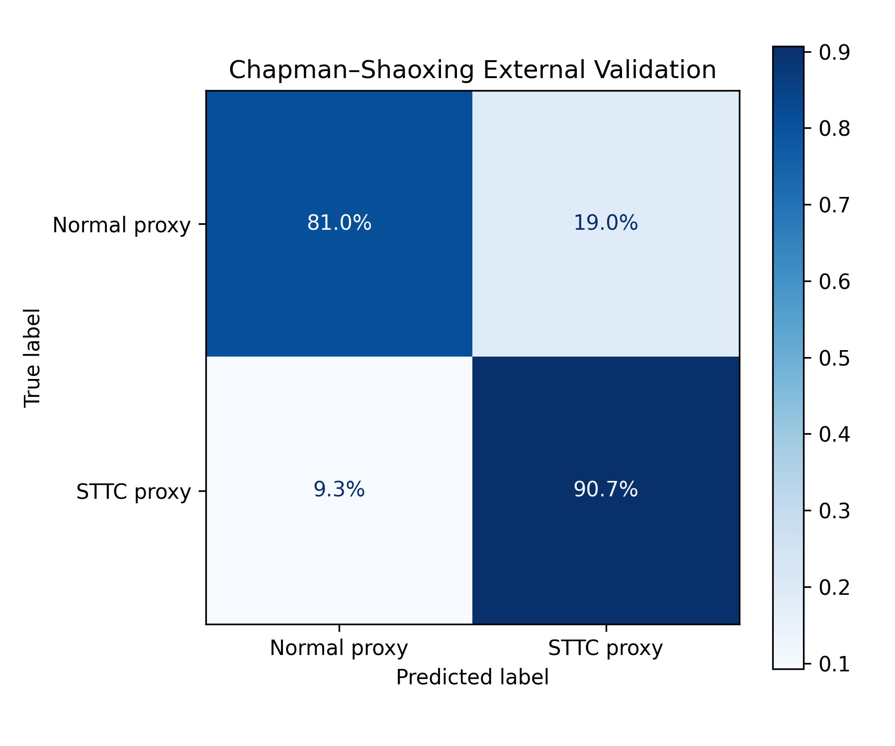

# External Validation — Chapman–Shaoxing ECG Dataset

## 1. Objective

Evaluate the generalisation of the PTB-XL-trained 1D CNN on an independent ECG dataset without additional model training.

## 2. Dataset and Methods

**Dataset:** Chapman–Shaoxing 12-lead ECG database

**Records evaluated:** 4,285

| Class | Definition | Records |
|---|---|---:|
| 0 | Sinus-rhythm-only diagnostic code (`426783006`) | 1,366 |
| 1 | One or more selected ST/T abnormality codes | 2,919 |

The positive class was constructed using SNOMED CT codes `428750005`, `429622005`, `164934002`, `59931005`, `164930006`, `164931005`, and `55930002`. Records not matching the selected labelling criteria were excluded.

### Preprocessing

- 12 standard ECG leads reordered to match PTB-XL
- 500 Hz sampling, 10-second recordings
- 0.5–40 Hz Butterworth band-pass filtering
- Per-lead z-score normalisation
- Output tensor shape: `(12, 5000)`

Preprocessed recordings were cached individually as NumPy arrays to reduce RAM usage and avoid repeated preprocessing.

### Model Evaluation

The existing pretrained `simpleECGNN` checkpoint was loaded without modification. The original validation-selected threshold of **0.3773** was retained for external evaluation.

No external recordings were used for training, fine-tuning, or threshold selection.

## 3. External Validation Results

| Metric | Result |
|---|---:|
| Accuracy | 87.61% |
| AUROC | 0.9342 |
| AUPRC | 0.9731 |
| F1 Score | 0.9089 |
| Sensitivity | 90.72% |
| Specificity | 80.97% |

### Confusion Matrix

| | Predicted Normal | Predicted STTC |
|---|---:|---:|
| Actual Normal | 1,106 | 260 |
| Actual STTC | 271 | 2,648 |

## 4. Interpretation and Limitations

External AUROC decreased from 0.9742 to 0.9342, indicating reduced but still substantial class discrimination. Sensitivity remained approximately constant, while specificity decreased from 92.76% to 80.97%.

An important limitation is the difference in annotation systems. PTB-XL uses diagnostic superclasses, whereas the external dataset was labelled using selected SNOMED CT codes. Sinus rhythm alone does not guarantee an otherwise normal ECG, and the selected ST/T codes do not necessarily reproduce the PTB-XL STTC superclass exactly.

Consequently, these results should be interpreted as preliminary cross-dataset validation rather than evidence of clinical diagnostic performance.
